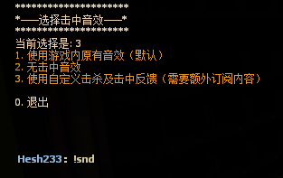

# 击中反馈分支

作者：TsukasaSato、Hesh233（分支）、night

版本：1.1.6-night

为玩家提供击中与击杀反馈，并允许每名玩家自行选择反馈声音。

## 游戏内指令

- `!snd`：选择默认音效、关闭所有命中反馈，或使用自定义击中与击杀反馈。选择后立即保存。

## 注意事项

- 普通感染者爆头时会播放击杀反馈。
- 自定义声音和图标位于 `addons/击杀及击中反馈.vpk`；插件不会自动把这些素材分发给玩家端。
- 玩家选择仍保存在 `addons/sourcemod/data/SoundSelect.txt`，更新时保留该文件。玩家通过 Steam 身份认证并读完设置前，不播放音效或显示图标。
- 如果提示保存失败，选择仍对本次连接生效。管理员可查看 SourceMod 错误日志，并检查服务器是否能写入上述存档。

